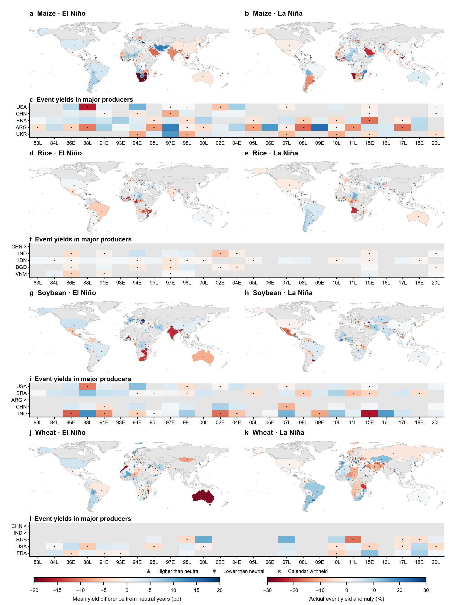
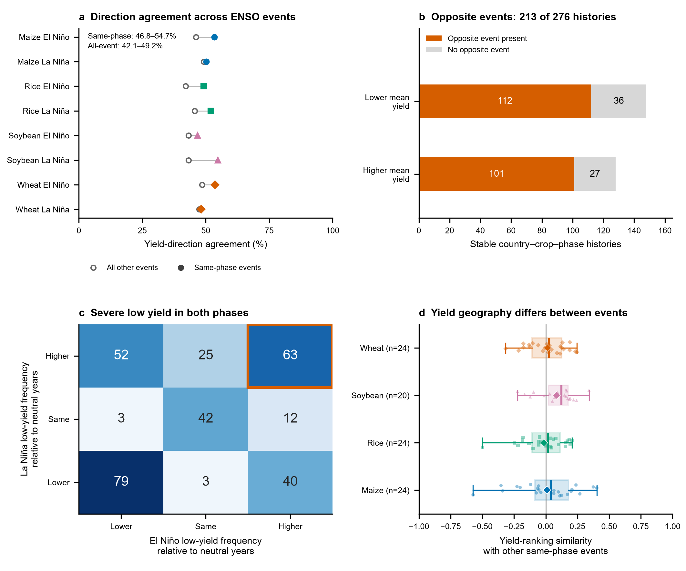
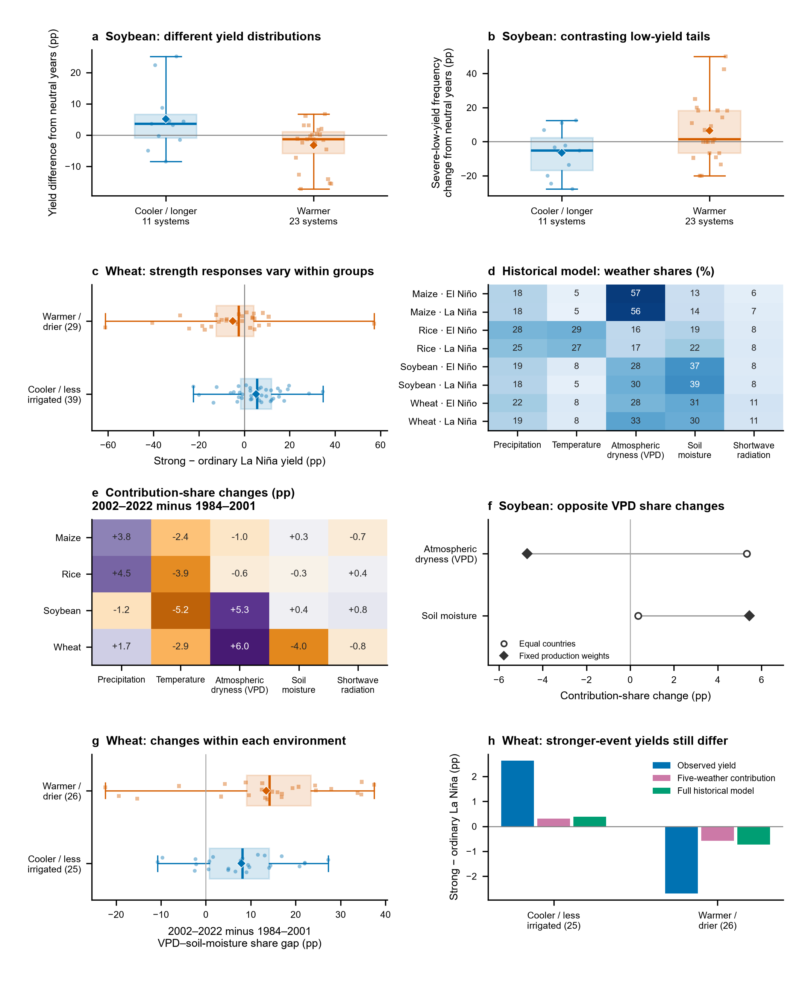
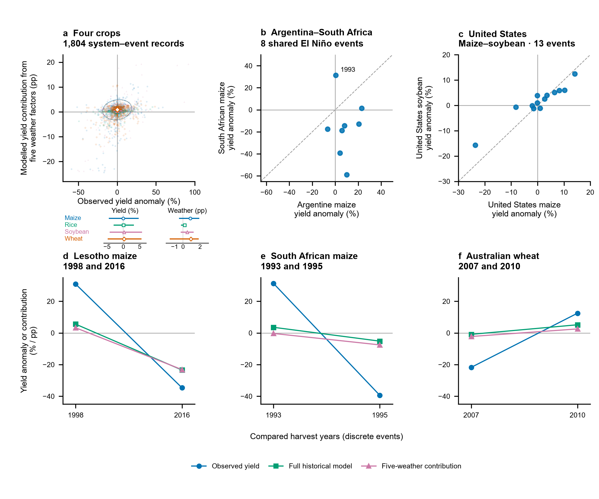
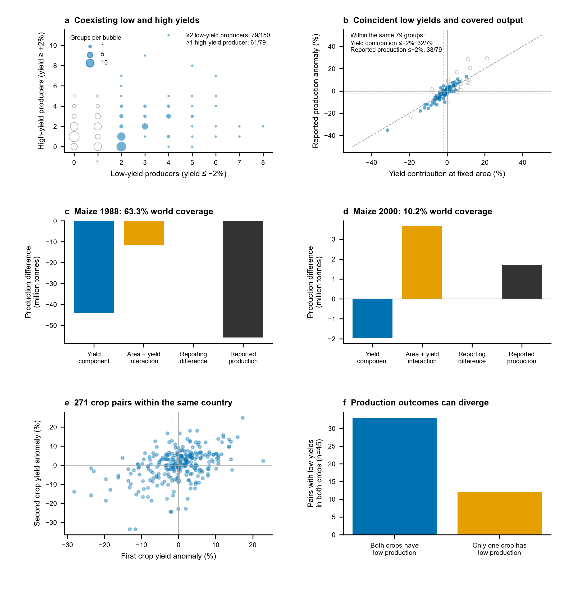
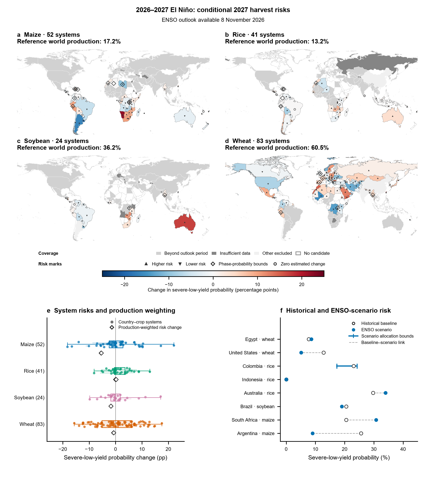

# ENSO phase tendencies and the geography of crop harvest risk

Historical El Niño and La Niña patterns provide useful information about crop yields, but an average relationship does not describe every harvest or the production it represents. This research companion connects four major crops—maize, rice, soybean and wheat—with individual ENSO events, growing environments, weather-model information and the geography of crop production.

## Why this study?

**How do historical ENSO–yield relationships relate to individual harvests, and what do those harvests mean for agricultural production across regions?**

The historical inventory covers 471 country–crop systems and 25 shared physical ENSO events during 1984–2022. Eligibility is assessed separately for each comparison; these totals are not the sample sizes of every result.

## Key findings

- **Historical tendencies and individual harvests.** Of 276 phase contrasts retaining direction under complete-event omission, 213 included a contrary event. A recurring average direction therefore did not rule out an opposite harvest.
- **Agricultural environments and weather.** During El Niño, cooler, longer-season soybean systems had a mean yield contrast of +5.13 percentage points relative to their majority-neutral years, whereas warmer systems had −3.21 pp. Weather models provide complementary descriptions of fitted yield variation, including different summaries under equal-system and production weighting.
- **Harvests and production.** In 61 of 79 groups where at least two major producers had low yields, other producers had gains. Producer size and harvested-area changes further altered the combined reported-production outcome.
- **Conditional risks for 2027.** The outlook information available by **8 November 2026** supported scenarios for 200 eligible systems: 52 maize, 41 rice, 24 soybean and 83 wheat. Risk rose in 43 wheat systems and fell in 38, while the fixed-production-weighted change over eligible wheat production was −0.80 to −0.71 pp. This is a dated research scenario, not a continuously updated forecast.

## Main figures

### Figure 1 — Historical ENSO phase–yield differences and individual event harvests across four major crops.

[Source data](source_data/main_figures/phase_and_event_maps/) · [Plotting code](code/visualization/phase_and_event_maps.py)

### Figure 2 — Historical ENSO tendencies, contrary harvests and geographic variability.

[Source data](source_data/main_figures/historical_environment_production/) · [Plotting code](code/visualization/historical_environment_production.py)

### Figure 3 — Yield distributions and weather contributions across agricultural environments.

[Source data](source_data/main_figures/historical_environment_production/) · [Plotting code](code/visualization/historical_environment_production.py)

### Figure 4 — Observed yield anomalies and modelled weather contributions during ENSO events.

[Source data](source_data/main_figures/event_weather_comparisons/) · [Plotting code](code/visualization/event_weather_comparisons.py)

### Figure 5 — Yield anomalies, harvested area and reported production among major producers.

[Source data](source_data/main_figures/historical_environment_production/) · [Plotting code](code/visualization/historical_environment_production.py)

### Figure 6 — Conditional severe-low-yield risks for 2027 harvests under the ENSO outlook.

[Source data](source_data/main_figures/conditional_risk/) · [Plotting code](code/visualization/conditional_risk.py)

## Explore the research

- [Research journey](RESEARCH_JOURNEY.md): the questions connecting the analyses.
- [Figures and source data](figures/README.md) and [figure/table index](docs/figure_and_table_index.md).
- [Complete supplementary results](results/README.md).
- [Data sources](DATA_SOURCES.md), [study design](docs/study_design.md) and [methods overview](docs/methods_overview.md).
- [Code](code/README.md) and [reproducibility scope](docs/reproducibility.md).

## Data and code availability

This repository provides six main-figure previews, 19 supplementary-figure previews, their indexed numerical evidence and complete CSV companions for 18 supplementary tables. The main-figure builders use stored inputs and do not train models. Original preprocessing modules and selected analysis functions are also provided. Full reconstruction from raw agricultural and weather products requires additional inputs and is not claimed to be independently reproducible from this repository alone.

Historical comparisons use RONI event assignments and centred five-year geometric references. The 2027 scenarios use a traditional Niño3.4 outlook and a separate trend reference. Associations and fitted weather contributions do not identify independent causal effects or physiological mechanisms. Production-weighted probability changes are not future production losses in tonnes.

## Citation and status

The associated study is titled *ENSO phase tendencies and the geography of crop harvest risk*. Author metadata and a permanent article citation will be added when confirmed. No publication DOI or acceptance status is asserted here. No project-wide reuse license has yet been assigned; see [rights and attribution](docs/rights_and_attribution.md). Upstream datasets retain their own terms.
